# EchoSub Lens

<a href="https://paypal.me/mfsafadi"></a>

**Translate the text on your screen, in place.** Pick an area, a whole screen, or let a small lens follow your
mouse — every piece of text in it is shown translated, right on top of the original, while you keep using the
page or program underneath. It also translates files — pictures, PDF, Word and subtitles — and movies: it
takes all the text of a movie into a subtitle file, ready to translate.

EchoSub Lens is the screen-translation tool of [EchoSub](https://github.com/mPhpMaster/echo-sub) (live, translated
captions for anything your PC plays), released here as a project of its own. It runs on its own, or beside EchoSub.

<p align="center">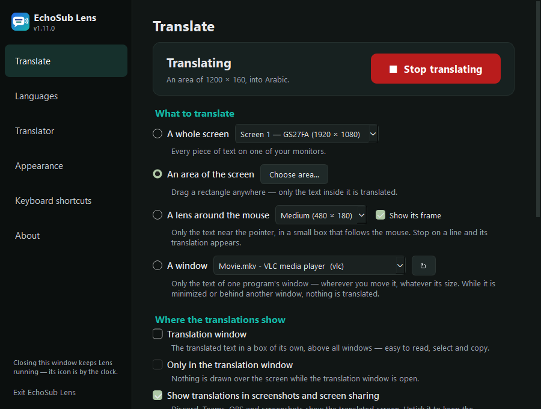</p>

## Screenshots

| | |
|---|---|
| 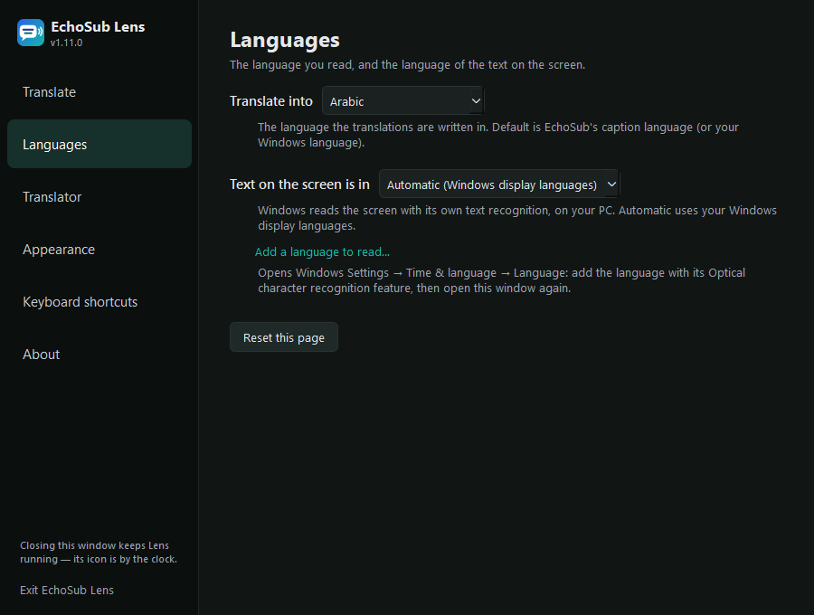 | 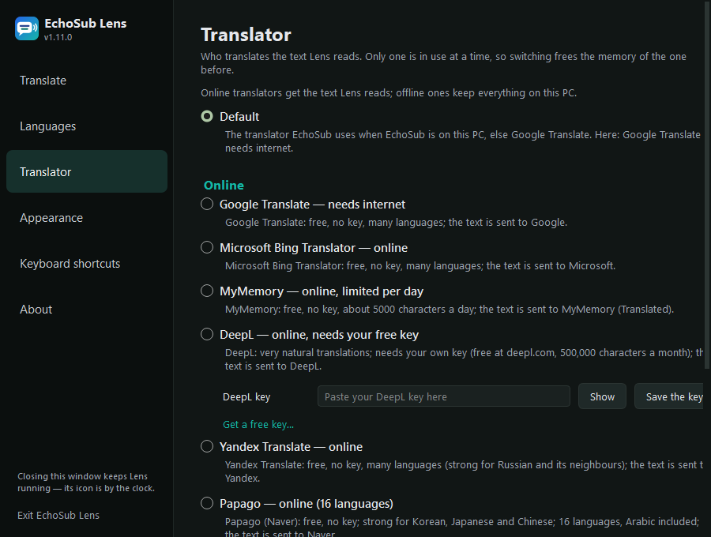 |
| *Languages: what to translate into, and the language of the text on the screen* | *Translator: Google, Microsoft Bing, MyMemory or DeepL online, or NLLB offline on your graphics card* |
| 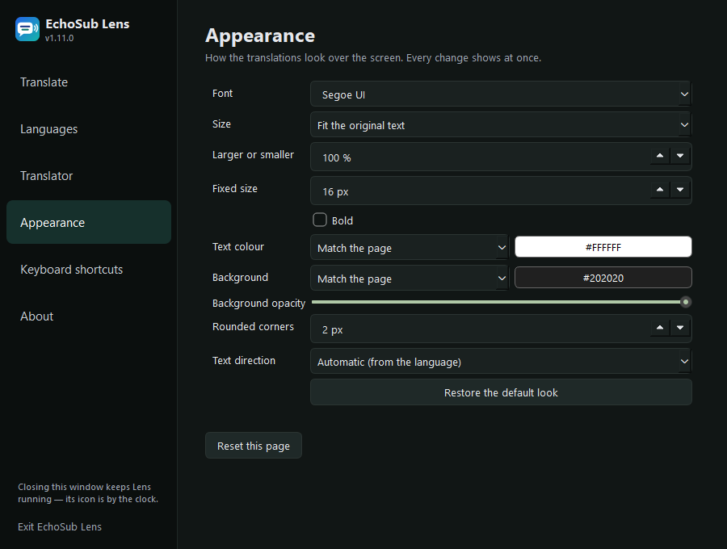 | 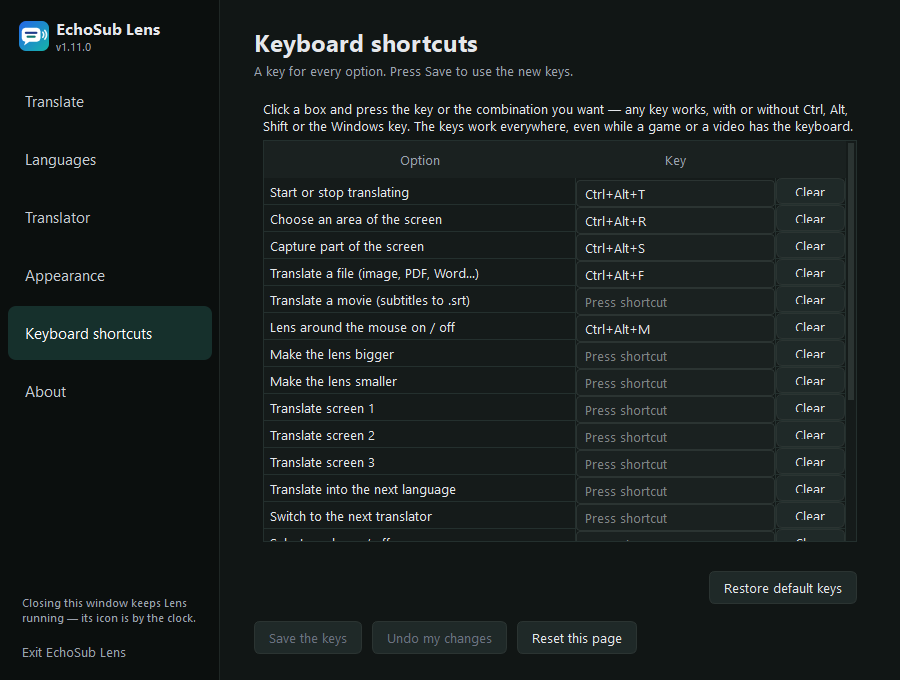 |
| *Appearance: font, size and colours, shown at once* | *A keyboard shortcut for every option* |
| 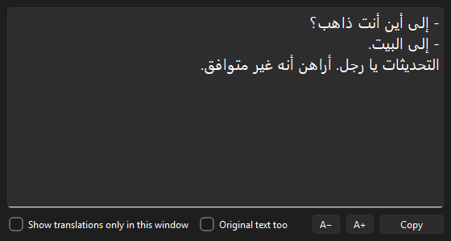 | 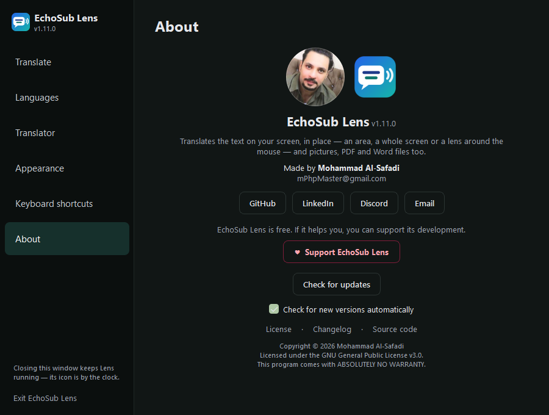 |
| *The translation window: a dialogue keeps a line, and its dash, for each speaker* | *About: version, author, links and ♥ support* |
| 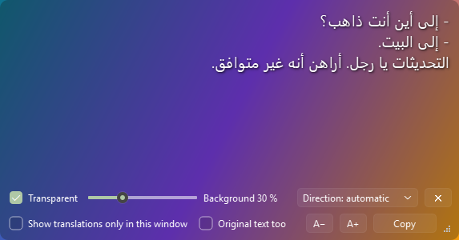 | 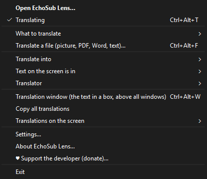 |
| *Transparent, as much as you like: only the words stay solid* | *The right-click menu, in groups* |
| 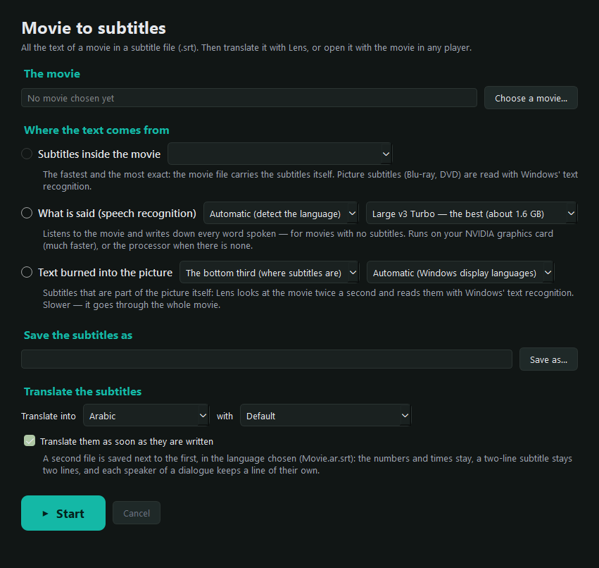 | 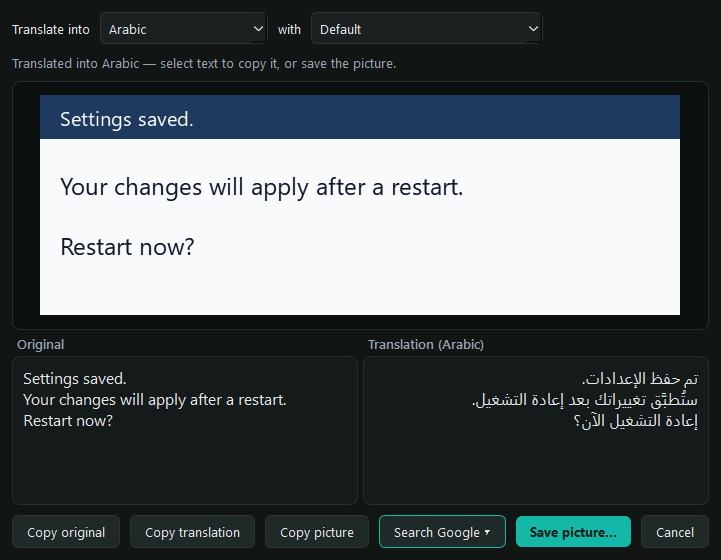 |
| *A movie to an .srt file: from its own subtitles, its speech or the text in its picture* | *Capture part of the screen: the original text and its translation side by side; copy, save, or search Google* |

<p align="center">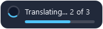<br>
<i>Everything Lens does shows in a small note in the corner of the screen.</i></p>

The pictures are made by `scripts\screenshots.py`.

## Features

**One window for everything**
- **Click the Lens icon by the clock** to open the EchoSub Lens window: a big *Start / Stop translating* button
  that shows what Lens is doing, and every option on a page of its own — *Translate*, *Languages*, *Translator*,
  *Appearance*, *Keyboard shortcuts* and *About* — each with a line that says what it does. Closing the window keeps
  Lens running by the clock; right-click the icon for the quick menu, in groups: start, what to translate,
  languages and translator, where the translations show, settings.
- **Reset this page** on every settings page puts its settings back to the defaults.
- *About*: the version, the author and his links (GitHub, LinkedIn, Discord, email), the license, the changelog
  and the source code.
- **New versions:** once a day Lens asks GitHub whether a newer version is out; when one is, it says so on the
  screen and the right-click menu gets *⬆ Update to …* (it opens the release page — Lens never downloads or runs
  anything by itself). *Check for updates* on the *About* page asks now; *Skip this version* or untick *Check for
  new versions automatically* to stop being told.

**What to translate**
- **An area** you drag on any screen (`Ctrl+Alt+R`), or **a whole screen** — one of your monitors.
- **A window**: choose a program's window (a video player, a game, a chat) and only its text is translated —
  wherever you move it and whatever its size. While it is minimized or behind another window, Lens waits.
- **A lens around the mouse** (`Ctrl+Alt+M`): only the text near the pointer, in a small framed box that follows
  the mouse. Stop on a line and its translation appears about half a second later. Four sizes, bigger / smaller.
- **A file** (`Ctrl+Alt+F`): pictures (PNG, JPG, BMP, GIF, TIFF, WebP), PDF (scanned ones too), Word `.docx`
  (headings, tables, bold and colours kept — only the words change), text and subtitle files (`.txt`, `.srt`, `.md`,
  `.csv`; subtitle numbers and times stay). Save a translated copy; the original is never changed.
- **A movie** (*Translate a movie (subtitles to .srt)…* in the menu, or *Translate a movie…* in the window): pick a
  movie (MKV, MP4, AVI, MOV, WebM, WMV, TS…) and Lens takes **all its text into an `.srt` file** — from the
  **subtitles inside the movie** (text tracks as they are; Blu-ray and DVD picture subtitles read with Windows'
  text recognition), from **what is said** (speech recognition with Whisper, on your NVIDIA graphics card or the
  processor, any language), or from **text burned into the picture** (read twice a second). A progress bar shows
  what it does and the time left. **Translate them into any language, with any translator** (Google, Microsoft
  Bing, MyMemory or DeepL online, or NLLB offline on your graphics card): with *Translate them as soon as they are written* on, a second file
  (`Movie.ar.srt`) is saved next to the first — numbers and times kept, a two-line subtitle still two lines, each
  speaker of a dialogue on a line of their own with their dash. *Translate the subtitles…* opens them in the file
  translator, in the language and with the translator chosen.
- **Capture part of the screen** (`Ctrl+Alt+S`, *Capture part of the screen…* in the menu, or *Capture* in the
  window): drag a rectangle and the picture opens in a window of its own, with **two boxes under it: the original
  text and its translation**, line for line (choose the language and the translator above). Select and copy from
  either, copy or **save the picture**, or cancel. Lens's own translations and windows are left out of the picture,
  and the screen translation goes on as before. **Search Google** from there, four ways: the picture (Google Lens),
  the picture with its translation drawn on it, the original text, or the translation (what you selected, or all).

**The translated text in a window of its own**
- **Translation window** (`Ctrl+Alt+W`): a window that stays above all others with the translated text in a box —
  read it, select it, copy it. Show the original under each line, change the font size, and keep or hide the
  translations over the screen. Make it **transparent**, as much as you like (the words stay solid, with a shadow),
  and choose the **text direction**: automatic, right to left or left to right.
- The translations over the screen can take a direction of their own too (*Appearance → Text direction*).

**While it translates**
- Press `Ctrl+Alt+T` — or *Start / Stop* in the window, or *Translating* in the right-click menu — to start or stop.
- Clicks, scrolling and typing go straight through to the page or program underneath.
- **Hold `Ctrl`** and the translations take the mouse: select a word or a sentence and press `Ctrl+C`, or
  right-click for *Copy this translation*, *Copy the original text* or *Copy all translations*. Hovering with `Ctrl`
  held shows the original. *Select mode* keeps them that way without holding `Ctrl`.
- The translations stay on the screen until the new ones are ready — no blinking over a video. Text already
  translated is remembered, so only new text is translated again.
- **Subtitles:** a dialogue (`- Where to?` / `- Home.`) keeps a line and a dash for each speaker, and a sentence
  over two lines is shown on two lines.

**Screen sharing**
- Translations show in screenshots and screen sharing (Discord, Teams, OBS), so the people watching see the
  translated screen — or untick *Show translations in screenshots and screen sharing* to keep them to yourself.
- Lens never reads its own words back: it leaves them out when it compares the screen, reads text only from a
  picture without them, and every second looks underneath for text that changed (adjustable, or never) — in a few milliseconds,
  without anything changing on the screen.

**Your way**
- *Appearance*: font, size (fitted to the original, larger or smaller, or one fixed size), bold, text and background
  colours (the page's own, or yours), background opacity and rounded corners — every change shows at once.
- *Keyboard shortcuts*: a key for every option — any key or combination, F-keys, the keypad and media keys too, with
  or without `Ctrl`, `Alt`, `Shift` or the Windows key. Keys used twice or held by another program are pointed out.
- Translate into ~200 languages; the text on the screen is read in any language whose Windows OCR pack is installed.

## How it works

- **Reading the screen:** Windows' own text recognition (Windows.Media.Ocr), on your PC and offline. To read another
  language, add it in *Settings → Time & language → Language* with its *Optical character recognition* feature.
- **Translating:** offline with NLLB-200 (on your graphics card or processor), or online with one of these:
  - **Google Translate** — free, no key. Gets every text of the screen in one request and answers each on its own;
    when one of its services says "too many requests", Lens asks another, and only pauses for a few seconds if all
    refuse.
  - **Microsoft Bing Translator** — free, no key (the same service as bing.com/translator). The lines of the screen
    go together, up to 1000 characters a request, and each keeps its own translation.
  - **MyMemory** (Translated srl) — free, no key and no sign-up, about 5000 characters a day; one request per text.
    When the day's limit is used up Lens says so: choose another translator or wait until the next day.
  - **DeepL** — needs your own key (free at [deepl.com/pro-api](https://www.deepl.com/pro-api), 500,000 characters a
    month), added on the *Translator* page. Up to 50 texts in one request; a key that is not valid or a month's
    quota used up is said in words.
  - **Yandex Translate** — free, no key; many languages, strong for Russian and its neighbours. Many texts in one
    request; texts in several languages at once are asked again so each is translated.
  - **Papago** (Naver) — free, no key; 16 languages (Korean, Japanese, Chinese, English, Arabic, French, German,
    Spanish, Russian, Portuguese, Italian, Vietnamese, Thai, Indonesian, Hindi), strong for Korean, Japanese and
    Chinese. Another language is said in words: choose another translator for it.

  *Default* follows EchoSub's choice when EchoSub is installed (and shares its downloaded models); otherwise it is
  your Windows language and Google Translate, which needs nothing downloaded. An NLLB model (about 600 MB or 1.3 GB)
  is downloaded the first time you choose it. Only one translator is loaded at a time: choosing another one frees the
  memory of the one before. When an online service limits requests, Lens waits a few seconds (longer each time) and
  asks again.
- **Movies:** PyAV (FFmpeg's own libraries, no `ffmpeg.exe` needed) reads the movie, its sound and its subtitle
  tracks; speech is recognized by faster-whisper (Large v3 Turbo by default, shared with EchoSub's models) only where
  someone speaks; burned-in text is read with Windows OCR, and the same text on frames in a row becomes one subtitle.

## Requirements

- Windows 10 version 2004 or later, or Windows 11 (64-bit).
- Python 3.10 to run from source.
- An NVIDIA graphics card is optional: NLLB runs on the processor too (it uses EchoSub's NVIDIA libraries if they
  are there).

## Install

Download `EchoSubLens-Setup-<version>.exe` from [Releases](https://github.com/mPhpMaster/echo-sub-lens/releases)
and run it — no administrator rights needed. You can check the download against the `.sha256` file next to it.

## Run from source

```bat
py -3.10 -m venv .venv
.venv\Scripts\pip install -r requirements.txt
run.bat
```

Or `.venv\Scripts\python -m echosub_lens [file]` — a file name opens that file to translate.
Settings are kept in `lens.json` and the log in `logs\lens.log`, in the project folder (or in
`%LOCALAPPDATA%\EchoSubLens` for a built copy; `ECHOSUB_LENS_DATA_DIR` overrides it).

## Movies from the command line

The subtitles of a movie without opening a window — for a batch of movies, or from a script:

```bat
"D:\Programs\EchoSub Lens\EchoSubLens.exe" --movie-to-srt "Movie.mkv" --from speech --language en
"D:\Programs\EchoSub Lens\EchoSubLens.exe" --movie-to-srt "Movie.mkv" --to ar --translator google
```

`--from` is `inside` (the movie's own text subtitles; `inside:N` for stream N), `speech` (speech recognition) or
`burned` (text in the picture); without it Lens uses the subtitles inside the movie when there are some, else the
speech. `--out` names the .srt file (default: next to the movie); a `.log` next to it says how it went.
`--to LANG` translates the subtitles too, into `Movie.LANG.srt` next to them (subtitles already in that language
are left as they are); `--translator` is `google`, `bing`, `mymemory`, `deepl`, `yandex`, `papago` (online; DeepL uses the key saved
in Lens), `nllb-600m` or `nllb-1.3b` (offline, on the graphics card when there is one), or `same` — the default: the
translator Lens uses.

## Build the installer

Needs Python 3.10 and [Inno Setup 6](https://jrsoftware.org/isdl.php).

```bat
powershell -ExecutionPolicy Bypass -File scripts\build-installer.ps1
```

It builds `dist\EchoSubLens\EchoSubLens.exe` with PyInstaller (`scripts\build.ps1`), then
`dist\installer\EchoSubLens-Setup-<version>.exe` and its SHA-256 hash.

## Tests

```bat
.venv\Scripts\python -m unittest discover -s tests
.venv\Scripts\python -m flake8 echosub_lens tests
```

The tests need no OCR language, model or network.

## Privacy

The picture of your screen never leaves your PC: it is read by Windows on your computer. With an NLLB translator
nothing is sent anywhere. With an online translator, the text Lens read is sent to the service you chose to be
translated — Google (Google Translate), Microsoft (Bing Translator), MyMemory (Translated srl), DeepL, Yandex
or Naver (Papago) — and that
service's privacy policy applies. *Search Google* in the capture window sends that picture to Google Lens (your browser sends it, from a page Lens writes on your PC) or its text to Google Search — only when you click it. Lens sends no email address or account of yours; your DeepL key is kept in Lens's
settings file on your PC and sent only to DeepL. Lens keeps no history of what it read.

Once a day Lens asks GitHub (api.github.com) for the number of the latest version. Nothing about you is sent —
no text, no key, no account or ID, only the name and version of Lens — and nothing is downloaded or installed by
itself. Untick *Check for new versions automatically* on the *About* page to turn it off.

## Support the developer

EchoSub Lens is free and always will be. If it helps you, you can support its development with a donation through
**[PayPal](https://paypal.me/mfsafadi)** — it is also in the app, under *♥ Support the developer* in the tray menu and on the *About* page.
It is entirely optional: nothing is held back, and Lens never asks.

## License

EchoSub Lens is Copyright © 2026 Mohammad Al-Safadi and licensed under the
[GNU General Public License v3.0](LICENSE) (GPL-3.0-only). It is built on PySide6 / Qt (LGPL-3.0), CTranslate2 (MIT),
SentencePiece (Apache-2.0), NumPy (BSD-3-Clause), Hugging Face Hub (Apache-2.0), deep-translator (MIT),
requests (Apache-2.0) and PyWinRT (MIT); the NLLB-200 models are CC-BY-NC-4.0 (Meta), downloaded on first use.
